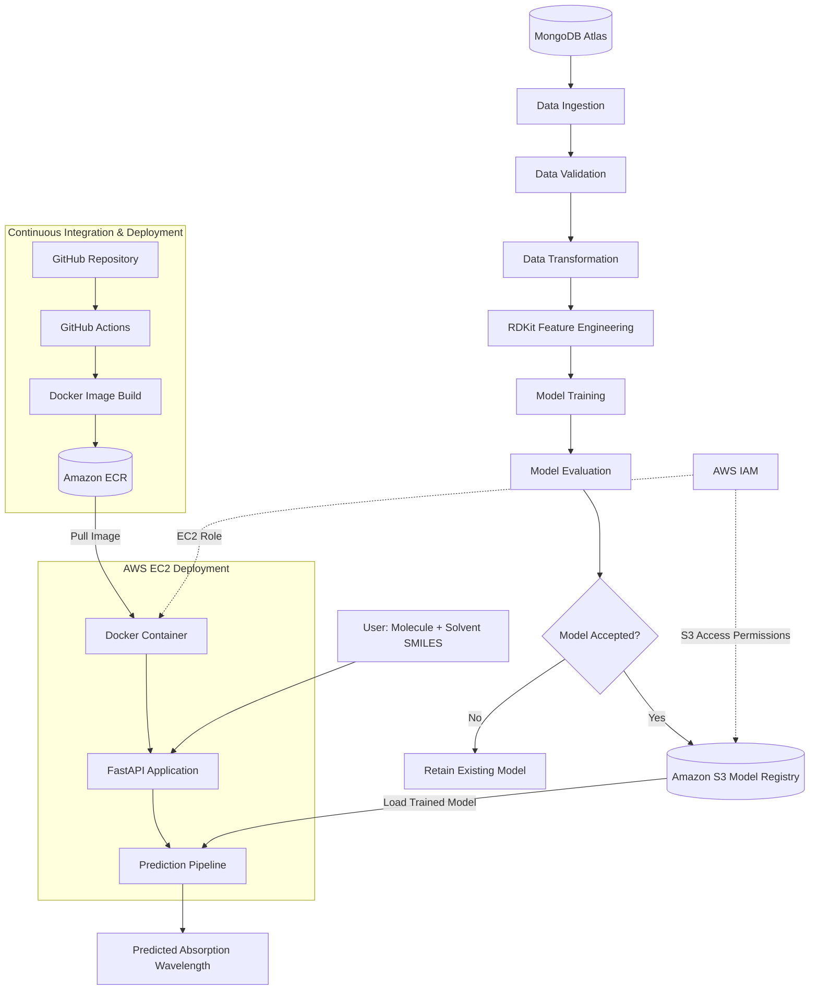
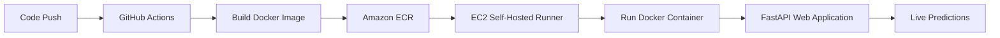

# Spectroscopic Property Predictor

### End-to-End Machine Learning & MLOps Pipeline for Molecular Property Prediction

An end-to-end machine learning application for predicting the **absorption wavelength (λmax)** of chromophores in different solvents using molecular SMILES representations.

The project combines **chemoinformatics, machine learning, cloud infrastructure, and MLOps** to implement a reproducible workflow covering data ingestion, molecular feature engineering, model training, evaluation, model registry, and automated deployment.

The trained model is served through an interactive web application deployed on **AWS EC2**, with automated CI/CD using **GitHub Actions, Docker, and Amazon ECR**.

## 1. Project Overview

Predicting molecular spectroscopic properties is relevant to photochemistry, molecular design, and materials research.

This project demonstrates how a machine learning model can be integrated into a modular, cloud-deployed prediction system.

**Input**
- Chromophore SMILES
- Solvent SMILES

**Output**
- Predicted absorption maximum (λmax), expressed in nanometers (nm)

**Core capabilities**
- Automated ingestion of molecular datasets from MongoDB Atlas
- Molecular feature engineering using RDKit
- Data validation and preprocessing
- Machine learning model training and evaluation
- Model comparison against an existing model
- Model artifact storage and retrieval using Amazon S3
- Interactive prediction interface
- Docker-based application deployment
- CI/CD automation with GitHub Actions
- Cloud hosting using AWS EC2
- AWS IAM-based access control

## 2. System Architecture

The architecture separates the **model training pipeline**, **model registry**, and **inference/deployment pipeline**.



### Architecture components

| Component | Technology | Responsibility |
|---|---|---|
| Data storage | MongoDB Atlas | Stores molecular and experimental data |
| Data ingestion | Python, Pandas | Retrieves data and prepares training datasets |
| Data validation | Python, YAML | Validates input schema and dataset structure |
| Feature engineering | RDKit | Generates molecular descriptors and fingerprints |
| Model training | Scikit-learn | Trains regression models |
| Model evaluation | Scikit-learn | Calculates regression metrics and compares models |
| Model registry | Amazon S3 | Stores trained model artifacts |
| Application backend | FastAPI | Handles prediction and training requests |
| Containerization | Docker | Packages the application and dependencies |
| Container registry | Amazon ECR | Stores application Docker images |
| Cloud deployment | Amazon EC2 | Hosts the running application |
| CI/CD | GitHub Actions | Automates image building and deployment |
| Access management | AWS IAM | Controls access to AWS resources |

## 3. Machine Learning Pipeline

The training pipeline is organized into independent components to improve maintainability, reproducibility, and debugging.

**Data Ingestion**

Connects to MongoDB Atlas, retrieves molecular records, converts them into a Pandas DataFrame, and generates training and testing datasets.

**Data Validation**

Validates the incoming dataset against the configured schema and checks the required columns and data structure before further processing.

**Data Transformation**

Converts molecular and solvent SMILES into numerical features using RDKit, preparing model-compatible input arrays.

**Model Training**

Trains a regression model to learn the relationship between molecular structure, solvent representation, and absorption wavelength.

**Model Evaluation**

Evaluates the candidate model using regression metrics such as:

- Mean Absolute Error (MAE)
- Root Mean Squared Error (RMSE)
- R² Score

The candidate model is compared against the previously stored model using the configured model acceptance criteria.

**Model Pusher**

Stores an accepted trained model in the Amazon S3 model registry, making it available for subsequent inference.

## 4. Model Serving and Prediction

The prediction service provides an interactive interface where users enter the SMILES representations of a chromophore and solvent.

The application:

1. Receives the molecular and solvent SMILES.
2. Generates the required molecular features.
3. Retrieves the trained model from Amazon S3.
4. Executes the regression prediction.
5. Returns the estimated absorption wavelength in nm.

The application also exposes a `/training` route to initiate the training workflow.

## 5. CI/CD and Cloud Deployment

The deployment pipeline uses **GitHub Actions, Docker, Amazon ECR, and Amazon EC2**.



### Continuous Integration

GitHub Actions executes the configured integration workflow and builds the application Docker image.

The image is pushed to Amazon ECR for storage and distribution.

### Continuous Deployment

The deployment workflow executes on an EC2 self-hosted GitHub Actions runner.

It authenticates with Amazon ECR, retrieves the application image, and starts the Docker container.

The running application loads the trained model from Amazon S3 using AWS credentials provided through the EC2 instance's IAM role.

### Cloud Infrastructure

- **Amazon S3:** Trained model storage
- **Amazon ECR:** Docker image registry
- **Amazon EC2:** Application hosting
- **AWS IAM:** Role-based permissions
- **GitHub Actions:** CI/CD orchestration

## 6. Technology Stack

| Category | Technologies |
|---|---|
| Programming | Python |
| Chemoinformatics | RDKit |
| Machine Learning | Scikit-learn, NumPy, Pandas |
| Database | MongoDB Atlas |
| Backend | FastAPI |
| Cloud | AWS S3, ECR, EC2, IAM |
| Containerization | Docker |
| Automation | GitHub Actions |
| Configuration | YAML, environment variables |
| Version Control | Git, GitHub |

## 7. Project Structure

```text
.
├── .github/
│   └── workflows/              # CI/CD automation
├── config/
│   └── schema.yaml             # Dataset validation configuration
├── src/
│   ├── cloud_storage/          # AWS S3 operations
│   ├── components/
│   │   ├── data_ingestion.py
│   │   ├── data_validation.py
│   │   ├── data_transformation.py
│   │   ├── model_trainer.py
│   │   ├── model_evaluation.py
│   │   └── model_pusher.py
│   ├── configuration/          # MongoDB and AWS connections
│   ├── constants/              # Project constants
│   ├── data_access/            # Database retrieval
│   ├── entity/                 # Configurations, artifacts, estimators
│   ├── exception/              # Custom exception handling
│   ├── logger/                 # Application logging
│   ├── pipeline/
│   │   ├── training_pipeline.py
│   │   └── prediction_pipeline.py
│   └── utils/                  # Shared utility functions
├── static/                     # CSS and static assets
├── templates/                  # Web interface
├── app.py                      # FastAPI application
├── Dockerfile                  # Container configuration
├── requirements.txt            # Python dependencies
├── setup.py                    # Package configuration
└── pyproject.toml              # Build configuration
```

## 8. Local Setup

**Prerequisites:** Python 3.10, Git, MongoDB Atlas access, and access to the configured AWS S3 model registry.

Clone the repository:

```bash
git clone <repository-url>
cd <repository-directory>
```

Create and activate a Python environment:

```bash
conda create -n spectroscopy python=3.10 -y
conda activate spectroscopy
```

Install dependencies:

```bash
pip install -r requirements.txt
```

Configure the required environment variables for MongoDB and AWS access. For production deployment, AWS IAM roles are preferred over long-lived access keys.

Run the application:

```bash
python app.py
```

Access the application locally at:

```text
http://127.0.0.1:5000
```

The application requires an accessible trained model in the configured S3 bucket for successful predictions.

## 9. Engineering Highlights

This implementation demonstrates practical experience across multiple areas of machine learning engineering.

**Machine Learning Engineering**
- Molecular feature engineering with RDKit
- Modular training and inference pipelines
- Regression model evaluation
- Model artifact serialization and reuse

**Software Engineering**
- Separation of configuration, components, entities, and pipelines
- Reusable Python modules
- Structured logging and exception handling
- Environment-based configuration

**MLOps and Cloud Engineering**
- Model registry using Amazon S3
- Docker containerization
- Automated CI/CD using GitHub Actions
- Amazon ECR image management
- EC2 application hosting
- IAM-based cloud authentication
- Debugging of container networking, cloud permissions, and resource constraints

## 11. Project Context

This project adapts an existing modular MLOps architecture to a **chemoinformatics regression problem**.

The domain-specific implementation focuses on molecular and solvent SMILES representations, RDKit-based feature engineering, and spectroscopic property prediction.

The work demonstrates the integration of scientific machine learning with software engineering and cloud deployment practices.

**Focus areas:** Machine Learning Engineering · Scientific AI · Chemoinformatics · MLOps · AWS Cloud Deployment

---

*The application is a machine learning demonstration and research-oriented prototype. Predictions are computational estimates and should not be treated as substitutes for experimental spectroscopic measurements.*